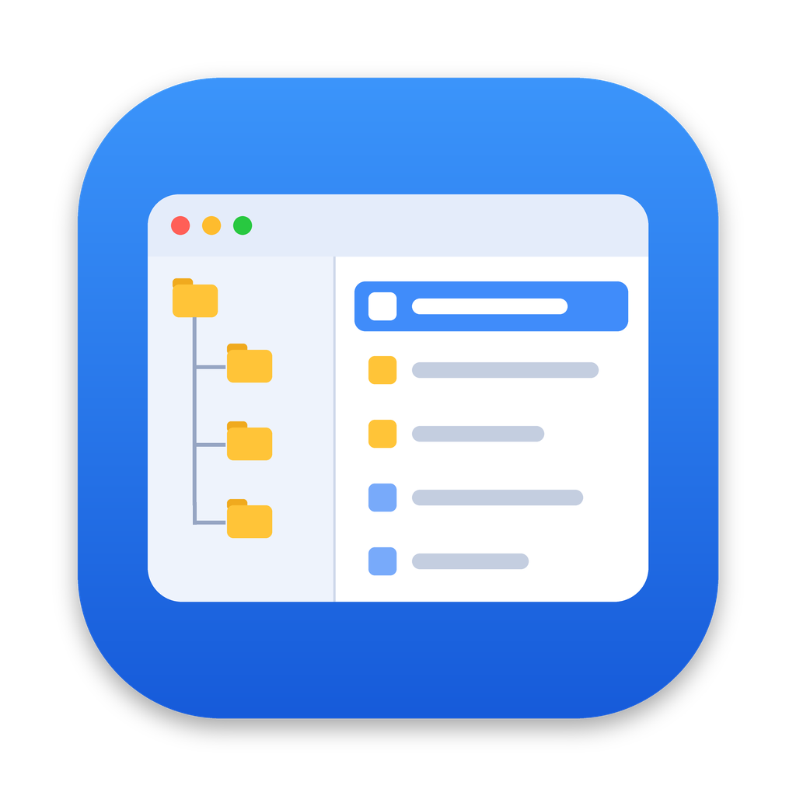

<p align="center">
  
</p>

<h1 align="center">Gezgin</h1>

<p align="center">
  macOS için Windows Explorer tarzı dosya yöneticisi.<br>
  Solda klasör ağacı, sağda seçili klasörün içeriği.
</p>

<p align="center">
  
  
  
</p>

> **English:** Gezgin ("Explorer" in Turkish) is a native macOS file manager with a Windows Explorer layout: a folder tree on the left, the selected folder's contents on the right. Written in Swift with SwiftUI and AppKit, no third-party dependencies. The interface is in Turkish.

## Neden?

Finder'da klasör ağacı yok. Windows'tan gelenler için "solda ağaç, sağda içerik" düzeni ve Enter ile açma, Backspace ile geri gitme, F2 ile yeniden adlandırma gibi alışkanlıklar Mac'te eksik kalıyor. Gezgin bu düzeni macOS'e yerel bir uygulama olarak getirir.

## Özellikler

**Klasör ağacı**
- Tek kök "Bu Mac"; altında ana klasör, Macintosh HD ve bağlı diskler
- Alt klasörler yalnızca açıldıklarında okunur
- Sağda gezindikçe ağaç geçerli klasöre kadar kendiliğinden açılır ve onu vurgular
- Windows tuşları: `↑` `↓` gezinir, `→` açar veya ilk alt klasöre iner, `←` kapatır veya üst klasöre çıkar
- Bağlı diskler (DMG, USB, harici disk) için çıkar düğmesi; disk takılıp çıkarılınca ağaç güncellenir

**Dosya listesi**
- Ad, değiştirilme tarihi, boyut ve tür sütunları; başlığa tıklayarak sıralama
- Klasörler her zaman üstte
- Enter veya çift tık: klasöre girer, dosyayı varsayılan uygulamasıyla açar
- Boşluk ile Hızlı Bakış
- Klasör içinde arama, gizli dosyaları gösterme
- Klasör dışarıdan değişirse liste kendiliğinden yenilenir

**İkon teması**
- Klasör adına (`.git`, `src`, `node_modules`, `docs`…) ve dosya uzantısına (`.swift`, `.json`, `.pdf`…) göre renkli, ayırt edici ikonlar
- Görünüm menüsünden macOS sistem ikonlarına dönülebilir
- Yalnızca Gezgin içinde görünür, dosyalara dokunmaz

**Dosya işlemleri**
- Kes, kopyala, yapıştır: sistem panosunu kullanır, Finder ile iki yönlü çalışır
- Sürükle-bırak: liste, ağaç ve Finder arasında; işlemden önce Taşı / Kopyala / Vazgeç diye sorar
- Yeni klasör, yeni metin belgesi, yeniden adlandırma, çoğaltma
- Silme her zaman Çöp Kutusuna taşır, kalıcı silmez
- Aynı adda öğe varsa üzerine yazılmaz, yeni ad verilir

**Sağ tık menüsü**
- Aç, Birlikte Aç, Kes, Kopyala, Çoğalt, Yeniden Adlandır, Çöp Kutusuna Taşı
- Yolu Kopyala, Finder'da Göster, Burada Terminal Aç

**Gezinme**
- Geri, ileri, üst klasör
- Tıklanabilir adres çubuğu: tam yol (`/Users/…`) veya görünen adlar, Görünüm menüsünden seçilir
- Klasöre Git: yolu yazarak gitme

## Kurulum

Xcode (veya Command Line Tools) kurulu bir Mac gerekir.

```bash
git clone https://github.com/echorulez/Gezgin.git
cd Gezgin
bash build.sh --release --install --run
```

Bu komut uygulamayı derler, `/Applications/Gezgin.app` olarak kurar ve açar.

### Derleme seçenekleri

| Komut | Sonuç |
|---|---|
| `bash build.sh` | Debug derleme: `dist/debug/Gezgin.app` |
| `bash build.sh --run` | Debug derler ve açar |
| `bash build.sh --release` | Release derleme: `dist/release/Gezgin.app` |
| `bash build.sh --release --dmg` | Ayrıca `dist/release/Gezgin.dmg` üretir |
| `bash build.sh --release --install` | `/Applications/Gezgin.app` olarak kurar |

Xcode ile çalışmak için `Package.swift` dosyasını açıp ⌘R yeterli.

## Kısayollar

| İşlem | Kısayol |
|---|---|
| Aç | Enter, çift tık, ⌘O, ⌘↓ |
| Geri / İleri | Backspace veya ⌘[ / ⌘] |
| Üst klasör | ⌘↑ |
| Kes / Kopyala / Yapıştır | ⌘X / ⌘C / ⌘V |
| Yeniden adlandır | F2 |
| Çoğalt | ⌘D |
| Çöp Kutusuna taşı | ⌘⌫ |
| Yeni klasör / Yeni metin belgesi | ⇧⌘N / ⌥⌘N |
| Hızlı Bakış | Boşluk |
| Klasöre git | ⇧⌘G |
| Burada Terminal aç | ⌥⌘T |
| Yolu kopyala | ⌥⌘C |
| Tam yolu göster/gizle | ⌥⌘P |
| Gezgin ikonları / sistem ikonları | ⌥⌘I |
| Gizli dosyalar | ⇧⌘. |
| Yenile | ⌘R |

Ok tuşları, en son tıklanan panelde çalışır: ağaca tıkladıysanız ağaçta, listeye tıkladıysanız listede.

## İzinler

- Masaüstü, Belgeler ve İndirilenler klasörlerine ilk girişte macOS izin sorar.
- Her yere erişim için Sistem Ayarları → Gizlilik ve Güvenlik → Tam Disk Erişimi bölümüne Gezgin'i ekleyin.
- Uygulama sandbox'sızdır ve ad-hoc imzalıdır. Kendi derlediğiniz Mac'te sorunsuz açılır; başka Mac'lere dağıtmak için Developer ID imzası ve notarization gerekir.

## Proje yapısı

```
Package.swift              Swift paketi tanımı
build.sh                   .app ve .dmg üreten script
Resources/AppIcon.icns     Uygulama simgesi
Sources/Gezgin/
  GezginApp.swift          Uygulama girişi ve menü komutları
  ExplorerModel.swift      Durum, gezinme, ağaç, pano ve dosya işlemleri
  SidebarView.swift        Klasör ağacı
  FileListView.swift       Dosya tablosu ve sağ tık menüsü
  ContentView.swift        Araç çubuğu, adres çubuğu, durum çubuğu, diyaloglar
  IconTheme.swift          İkon teması (ad ve uzantı eşlemeleri)
  FileItem.swift           Veri türleri
```

## Yol haritası

- Sekmeler ve çoklu pencere
- İkon görünümü
- Satır içi yeniden adlandırma
- Kopyalama ilerleme göstergesi ve iptal
